# Reliable RAG Knowledge Assistant

A FastAPI service that ingests documents (PDF, TXT, Markdown), indexes them with persistent vector embeddings, and answers user questions strictly from retrieved passages. If the required information is not present in the indexed documents, the service explicitly refuses to answer and will not invent facts.

---

## Architecture

The system enforces an explicit refusal and grounding verification path to prevent hallucinations:

```mermaid
flowchart TD
    subgraph Ingestion Pipeline
        A[File Upload: PDF / TXT / MD] --> B[Validation: Type, Size, Non-empty]
        B --> C[SHA-256 Hash Deduplication]
        C --> D[Boundary-Aware Chunker]
        D --> E[Batch Embeddings]
        E --> F[(ChromaDB Persistent Store)]
    end

    subgraph Query & Verification Pipeline
        Q[User Query: POST /ask] --> R[Embed Query]
        R --> S[Vector Search Top-K]
        S --> T{Score >= Threshold?}
        T -- No Chunks Pass --> U[Direct Refusal: Information Unavailable]
        T -- Chunks Pass --> V[Injection-Hardened Context Prompt]
        V --> W[LLM Client: Temperature 0]
        W --> X{Grounding Validation}
        X -- Malformed / Hallucinated Citation --> Y[Retry Prompt Once]
        Y -- Still Invalid --> U
        X -- Valid Citations --> Z[Extract Verbatim Excerpts & Return Sources]
    end
```



---

## Design Decisions and Trade-Offs

### Vector Store: ChromaDB vs FAISS
- **Choice**: ChromaDB (`PersistentClient`).
- **Rationale**: ChromaDB provides built-in metadata persistence via SQLite alongside its HNSW index on disk. This enables document filtering, chunk deletion by document ID, and registry management out of the box without maintaining a separate database.
- **Trade-off**: FAISS is lighter and faster for massive in-memory scale, but requires manually implementing metadata indexing, document registries, and on-disk synchronization.

### Embedding Model: SentenceTransformers `all-MiniLM-L6-v2`
- **Choice**: `all-MiniLM-L6-v2` (384 dimensions).
- **Rationale**: Generates normalized cosine embeddings locally with zero API cost, runs offline, and produces high semantic discrimination for technical text.
- **Trade-off**: Larger models (such as BGE-Large or OpenAI `text-embedding-3-large`) provide slightly better nuance on complex queries, but increase latency and memory consumption.

### Chunk Size (500) and Overlap (100)
- **Rationale**: 500 characters corresponds to approximately 2-3 focused sentences or a short paragraph. This ensures retrieved chunks fit narrow factual queries without diluting context across multiple unrelated topics. The 100-character overlap prevents sentences and headings at chunk boundaries from being truncated.

### Similarity Threshold (0.38)
- **Rationale**: Cosine similarity in `all-MiniLM-L6-v2` for unrelated domain topics (e.g., questions about geography vs. cloud storage specifications) scores below 0.25. Setting the threshold at 0.38 admits relevant technical queries while filtering out completely irrelevant queries before invoking the LLM, reducing latency and cost.

### Explicit Refusal Path
- **Rationale**: Rather than letting the LLM guess or rely on pre-trained parametric knowledge when relevant documents are absent, the service enforces a multi-tier refusal path:
  1. Pre-LLM threshold filter (retrieval score < threshold skips LLM entirely).
  2. Strict system prompt with instruction hierarchy instructing refusal when facts are missing.
  3. Post-LLM citation validator that inspects whether cited chunk IDs exist in the retrieved candidate set.

### Session Isolation & Ephemeral Lifecycle
- **Rationale**: User uploads must only exist for the duration of the browser tab / user session and must never leak across users:
  1. **Session-Scoped Collections**: Vector embeddings and chunks are stored in dedicated Chroma collections (`session_<uuid32>`) tied to each session ID.
  2. **Zero In-Browser Persistence**: The session ID is generated in memory (`crypto.randomUUID()`) and never saved to `localStorage`, `sessionStorage`, or cookies. Refreshing the browser instantly creates a fresh empty session.
  3. **Multi-Stage Cleanup**:
     - **Page Unload**: The client fires a `navigator.sendBeacon` to `POST /session/end?session_id=<uuid>` on `pagehide` to cleanly delete the collection and documents immediately.
     - **Explicit Delete**: Clients can call `DELETE /session` to wipe their session.
     - **Background TTL Cleaner**: A background worker runs every 60 seconds to purge collections that have been idle longer than `SESSION_TTL_MINUTES` (default 30 min).
     - **Startup Sweep**: Service boot automatically purges any stale `session_*` collections left from previous server runs or crashes.
  4. **Session Limits**: Enforces `MAX_FILES_PER_SESSION` (default 10) and `MAX_TOTAL_UPLOAD_MB` (default 25 MB) returning HTTP 413 when breached.

---

## Environment Variables

| Variable | Type | Default | Description |
|---|---|---|---|
| `APP_ENV` | string | `development` | Runtime environment (`development`, `production`) |
| `HOST` | string | `0.0.0.0` | Bind host address |
| `PORT` | int | `8000` | Application port |
| `CHROMA_PERSIST_DIR` | string | `./data/chroma_db` | Storage path for persistent vector database |
| `CHROMA_COLLECTION_NAME` | string | `rag_documents` | Target collection name in ChromaDB |
| `EMBEDDING_PROVIDER` | string | `sentence-transformers` | Provider: `sentence-transformers` or `openai` |
| `EMBEDDING_MODEL` | string | `all-MiniLM-L6-v2` | Model name or path for embeddings |
| `LLM_PROVIDER` | string | `mock` | LLM client: `gemini`, `openai`, `anthropic`, `ollama`, or `mock` |
| `LLM_MODEL` | string | `gemini-2.5-flash` | Model identifier |
| `LLM_API_KEY` | string | `""` | API key for Gemini / OpenAI / Anthropic |
| `LLM_BASE_URL` | string | `""` | Optional endpoint URL (for Ollama or custom gateway) |
| `LLM_TEMPERATURE` | float | `0.0` | Sampling temperature (0.0 for deterministic answers) |
| `LLM_TIMEOUT_SECONDS` | float | `30.0` | HTTP request timeout in seconds |
| `LLM_MAX_RETRIES` | int | `2` | Number of retry attempts on provider failure |
| `CHUNK_SIZE` | int | `500` | Character count per chunk |
| `CHUNK_OVERLAP` | int | `100` | Overlap character count between consecutive chunks |
| `TOP_K` | int | `4` | Default number of chunks retrieved |
| `SIMILARITY_THRESHOLD` | float | `0.38` | Minimum similarity score required for context passage |
| `MAX_FILE_SIZE_MB` | int | `10` | Maximum upload file size in megabytes |
| `ALLOWED_EXTENSIONS` | string | `.pdf,.txt,.md` | Comma-separated list of accepted extensions |
| `SESSION_TTL_MINUTES` | int | `30` | Minutes of inactivity before an idle session is automatically cleaned up |
| `MAX_FILES_PER_SESSION` | int | `10` | Maximum number of files permitted per session |
| `MAX_TOTAL_UPLOAD_MB` | int | `25` | Maximum cumulative upload size in megabytes per session |

---

## Setup and Installation

### Local Setup

Requirements: Python 3.11+

```bash
# 1. Clone repository
git clone <repo-url>
cd rag-assistant

# 2. Create virtual environment
python3 -m venv .venv
source .venv/bin/activate

# 3. Install dependencies
pip install -r requirements.txt

# 4. Configure environment
cp .env.example .env
# Edit .env with your LLM_PROVIDER and LLM_API_KEY if using a live cloud model

# 5. Start the service
uvicorn app.main:app --host 0.0.0.0 --port 8000 --reload
```

The service is now running at `http://localhost:8000`. You can access the developer UI directly in your browser.

### Docker Setup

```bash
# Build and run with Docker Compose
docker compose up -d --build

# Inspect service logs
docker compose logs -f

# Check container health status
docker inspect --format='{{json .State.Health}}' rag-assistant
```

---

## API Usage

### 1. Check System Health
```bash
curl -X GET http://localhost:8000/health
```

**Response (200 OK):**
```json
{
  "status": "ok",
  "index_loaded": true,
  "active_sessions": 2,
  "embedding_model": "all-MiniLM-L6-v2",
  "llm_provider": "gemini"
}
```

> **Note on Sessions**: All document and query operations require the `X-Session-ID` header containing a valid UUID (e.g. `X-Session-ID: 7a82cf55-a01c-4395-9271-bf75c7e3f890`). All documents uploaded exist solely within that session.

### 2. Upload Documents
Upload one or more `.pdf`, `.txt`, or `.md` files:

```bash
curl -X POST http://localhost:8000/documents \
  -H "X-Session-ID: 7a82cf55-a01c-4395-9271-bf75c7e3f890" \
  -F "files=@data/sample_docs/hr_benefits_policy.md" \
  -F "files=@data/sample_docs/cloud_storage_spec.txt"
```

**Response (201 Created):**
```json
{
  "files": [
    {
      "document_id": "9136fb96f89d640b",
      "filename": "hr_benefits_policy.md",
      "status": "indexed",
      "total_chunks": 6,
      "pages": null,
      "error": null,
      "preview": "# Acme Corporation Benefits Summary..."
    }
  ],
  "uploaded": [ ... ],
  "skipped": [],
  "message": "Processed 2 files: 2 indexed, 0 duplicates, 0 failed"
}
```

### 3. Inspect Document Chunks
```bash
curl -X GET http://localhost:8000/documents/9136fb96f89d640b/chunks \
  -H "X-Session-ID: 7a82cf55-a01c-4395-9271-bf75c7e3f890"
```

### 4. List Ingested Documents
```bash
curl -X GET http://localhost:8000/documents \
  -H "X-Session-ID: 7a82cf55-a01c-4395-9271-bf75c7e3f890"
```

### 5. Delete a Document
```bash
curl -X DELETE http://localhost:8000/documents/9136fb96f89d640b \
  -H "X-Session-ID: 7a82cf55-a01c-4395-9271-bf75c7e3f890"
```

### 6. Delete an Entire Session
```bash
curl -X DELETE http://localhost:8000/session \
  -H "X-Session-ID: 7a82cf55-a01c-4395-9271-bf75c7e3f890"
```
*(Also supports `POST /session/end?session_id=<uuid>` for browser `navigator.sendBeacon` upon tab close or page reload).*

### 7. Ask a Grounded Question
```bash
curl -X POST http://localhost:8000/ask \
  -H "Content-Type: application/json" \
  -H "X-Session-ID: 7a82cf55-a01c-4395-9271-bf75c7e3f890" \
  -d '{
    "question": "What is the monthly employee premium for the Gold Premier plan?",
    "top_k": 3
  }'
```

**Response (200 OK - Answerable):**
```json
{
  "answer": "Gold Premier Plan: $120 monthly employee premium contribution.",
  "answerable": true,
  "sources": [
    {
      "document": "hr_benefits_policy.md",
      "chunk_id": "9136fb96f89d640b_p0_c0",
      "page": null,
      "excerpt": "Gold Premier Plan: $120 monthly employee premium contribution. Comprehensive coverage with a $500 annual individual deductible, 90% in-network coinsurance, and full prescription drug coverage.",
      "score": 0.6841
    }
  ]
}
```

### 8. Ask an Unanswerable / Out-of-Scope Question
```bash
curl -X POST http://localhost:8000/ask \
  -H "Content-Type: application/json" \
  -H "X-Session-ID: 7a82cf55-a01c-4395-9271-bf75c7e3f890" \
  -d '{
    "question": "What is the monthly subscription cost for Acme Cloud Storage Platinum tier?"
  }'
```

**Response (200 OK - Unanswerable):**
```json
{
  "answer": "I couldn't find this information in the provided documents.",
  "answerable": false,
  "sources": []
}
```

---

## Testing

The test suite runs completely offline with deterministic mock providers for both embeddings and LLM calls.

```bash
# Run pytest with code coverage
.venv/bin/python -m pytest tests/ -v --cov=app --cov-report=term-missing
```

### Test Suite Structure
- `tests/test_chunking.py`: Boundary awareness, markdown headers, paragraph preservation, overlap consistency, PDF page mapping, and ingestion validations.
- `tests/test_retrieval.py`: Vector search ranking, similarity threshold cutoff, document deletion from index, empty store behavior.
- `tests/test_api.py`: Upload success, duplicate deduplication, 415 unsupported type, 400 empty file, 422 payload validation, /ask answerable and unanswerable flows.
- `tests/test_failure_cases.py`: Empty index handling, sub-threshold query short-circuiting, malformed LLM JSON recovery, hallucinated citation rejection, prompt injection resilience in context documents, and optional live provider integration test.

---

## Evaluation Benchmark

The evaluation suite tests 14 benchmark questions across 3 categories:
1. **Answerable (single source)**: Factual questions substantiated by one document passage.
2. **Unanswerable (near-miss and out-of-scope)**: Queries requesting non-existent tiers (e.g. Platinum tier), non-existent severity levels (Severity 4), unmentioned benefits (travel meals), and external domain topics (Australia).
3. **Multi-evidence**: Questions requiring synthesis across multiple chunks or sections.

### Running the Evaluation
```bash
.venv/bin/python eval/run_eval.py
```

### Benchmark Results

| Metric | Result | Target |
|---|---|---|
| **Total Test Questions** | 14 | 12+ |
| **Overall Decision Accuracy** | **100.0%** (14/14) | > 85% |
| **Correct Refusal Rate** | **100.0%** (5/5) | > 90% |
| **Source Document Recall** | **100.0%** (9/9) | > 80% |
| **Fact / Keyword Coverage** | **95.7%** (22/23) | > 80% |

Results are saved to `eval/results.json`.

---

## Known Limitations

1. **Scanned PDFs without OCR**: The ingestion service relies on native PDF text stream extraction via `pypdf`. Image-only or scanned documents without embedded text layers are rejected with a clear 400 error rather than passed through OCR.
2. **Single-Node Vector Storage**: ChromaDB runs locally against SQLite and local disk. For multi-node distributed scaling, a dedicated cluster (e.g. Qdrant or Milvus) would be required.
3. **No Cross-Encoder Reranker**: Retrieval relies on dense bi-encoder embeddings and diversity filtering. Adding a cross-encoder reranking step (such as `bge-reranker-base`) would improve precision on complex queries at the expense of added latency.
4. **Authentication & Authorization**: The API endpoints are open and do not include user authentication or document-level access control (RBAC).
5. **English-Focused Tokenization**: The boundary and sentence splitters are tuned primarily for English punctuation and whitespace conventions.
6. **In-Memory Session Registry Boundary**: Per-session document metadata and TTL timestamps are stored in-process on the local server. For horizontal multi-instance scaling behind a load balancer, session state would be stored in a shared distributed cache (e.g., Redis).

---

## Future Improvements

1. **OCR Pipeline**: Integrate an asynchronous OCR worker (e.g. Tesseract or Google Cloud Document AI) for image-based PDFs.
2. **Hybrid Search**: Combine BM25 lexical keyword search with dense vector embeddings via Reciprocal Rank Fusion (RRF).
3. **Cross-Encoder Reranking**: Run candidate passages through a lightweight reranker model before context compilation.
4. **Streaming Response Endpoint**: Implement Server-Sent Events (`text/event-stream`) on `POST /ask` for real-time token streaming with client-side citation rendering.
5. **Role-Based Access Control**: Add API key authentication and workspace isolation so documents can be scoped to specific users or teams.
